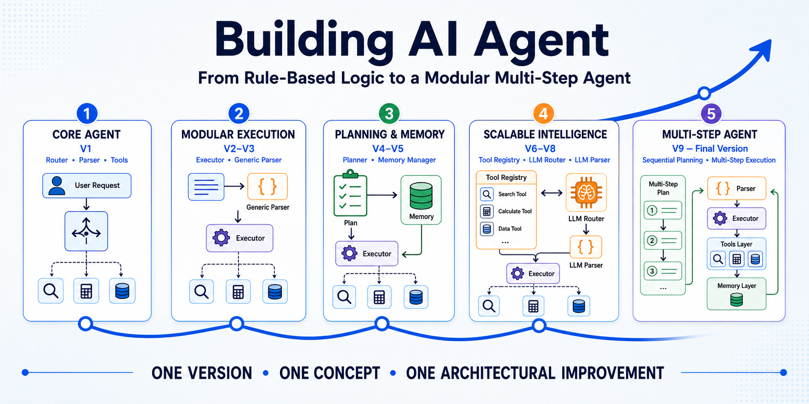

# Building AI Agent

A progressive educational project that shows how to build an AI agent step by step, from scratch, using pure Python.

The current version completes the original roadmap with multi-step execution. A small local pretrained language model is used for both semantic tool routing and argument parsing, without using an external inference API or an agent framework. Each version introduces one new architectural concept, making routing, planning, parsing, tool execution and memory easier to understand step by step.

  [](LICENSE) [](https://www.kaggle.com/code/lucalullo/building-ai-agent)

[Kaggle notebook](https://www.kaggle.com/code/lucalullo/building-ai-agent) · [GitHub repository](https://github.com/lucalullo/building-ai-agent) · [Technical report](project-report-en.pdf)



## Overview

The complete project evolves through five main stages:

1. core agent;
2. modular execution;
3. planning and managed memory;
4. scalable intelligence with a Tool Registry and LLM integration;
5. multi-step execution.

Each stage introduces one architectural improvement while preserving the concepts developed in the previous versions.

## Current capabilities

- receive a natural-language request;
- identify the user's intent semantically;
- select the most appropriate tool through a local LLM Router;
- create a simple execution plan;
- create multiple sequential steps for requests connected by `then`;
- explain why each selected tool should be used;
- determine which arguments are required;
- extract arguments through a local LLM Parser;
- understand numeric arguments expressed as words;
- validate the extracted arguments;
- execute the selected tools;
- pass the result of one step to the next when the request refers to `the result`;

## Architecture

```text
User Request
      ↓
   Planner
      ↓
Step 1 (LLM Router → LLM Parser → Executor)
      ↓
Step 2 (LLM Router → LLM Parser → Executor)
      ↓
     ...
      ↓
Memory Manager
      ↓
    Memory
      ↓
    Output
```

The Planner can split a sequential request into multiple steps and uses the LLM Router to select the most appropriate tool for each step.

The LLM Router uses a small local pretrained language model to select tools semantically from the names and descriptions stored in the Tool Registry.

The LLM Parser uses the same local language model to extract the arguments required by the selected tool and returns them as structured JSON.

## Version guide

| Version | Focus | Notebook and resources |
|---:|---|---|
| 1 | Agent Base | [`v1-agent-base/`](v1-agent-base/) |
| 2 | Executor | [`v2-executor/`](v2-executor/) |
| 3 | Generic Parser | [`v3-generic-parser/`](v3-generic-parser/) |
| 4 | Planner | [`v4-planner/`](v4-planner/) |
| 5 | Memory Manager | [`v5-memory-manager/`](v5-memory-manager/) |
| 6 | Tool Registry | [`v6-tool-registry/`](v6-tool-registry/) |
| 7 | LLM Router | [`v7-llm-router/`](v7-llm-router/) |
| 8 | LLM Parser | [`v8-llm-parser/`](v8-llm-parser/) |
| 9 | Multi-Step Agent | [`v9-multi-step-agent/`](v9-multi-step-agent/) |

### What each version introduces

<details>
<summary>Version 1 - Agent Base</summary>

The first version introduces the complete basic agent flow:

In this version, the Agent directly coordinates the components and executes the selected tool.

</details>

<details>
<summary>Version 2 - Executor</summary>

The second version introduces a dedicated Executor component:

Tool validation and execution are separated from the Agent, improving the separation of responsibilities.

</details>

<details>
<summary>Version 3 - Generic Parser</summary>

The third version introduces a generic parsing mechanism based on the parameters required by each tool.

This reduces tool-specific conditions inside the Parser and prepares the architecture for:

- new tools;
- reusable parameter extractors;
- more flexible parsing;
- future LLM integration.

</details>

<details>
<summary>Version 4 - Planner</summary>

The fourth version introduces a dedicated Planner component.

The agent no longer moves directly from tool selection to parsing and execution. It first creates a simple execution plan describing:

- the selected tool;
- the reason for selecting it;
- the arguments required by the tool.

</details>

<details>
<summary>Version 5 - Memory Manager</summary>

The fifth version introduces a dedicated Memory Manager component.

The Agent no longer writes directly to the memory list. Instead, it delegates memory operations to dedicated functions:

- `save_to_memory(state)`;
- `get_memory()`;
- `get_last_interaction()`;
- `clear_memory()`.

</details>

<details>
<summary>Version 6 - Tool Registry</summary>

The sixth version introduces a centralized Tool Registry.

Tool functions and their metadata are no longer distributed across separate structures. Each tool is registered together with:

- the tool function;
- the required parameters;
- a short description;
- the synonyms used by the rule-based Router.
- the Router reads registered synonyms;

</details>

<details>
<summary>Version 7 - LLM Router</summary>

The seventh version introduces the first language-model-based component: the LLM Router.

The Router no longer selects tools by scoring manually registered synonyms. Instead, it uses a small pretrained language model running locally inside the notebook:

- the user's request;
- the registered tool names;
- the registered tool descriptions.

</details>

<details>
<summary>Version 8 - LLM Parser</summary>

The eighth version introduces the LLM Parser.

The Router continues to use the local pretrained language model introduced in Version 7 to select the most appropriate tool.

</details>

<details>
<summary>Version 9 - Multi-Step Agent</summary>

The ninth version introduces multi-step execution and completes the original project roadmap.

The Planner can now split a sequential request into multiple steps. Each step is routed independently, and the Agent executes the resulting plan one step at a time.

</details>

## Getting started

### Requirements

- Python 3
- Jupyter Notebook or JupyterLab
- PyTorch
- Transformers
- Hugging Face Hub

No external agent framework is required. Versions 7, 8 and 9 download the pretrained language model from Hugging Face and run inference locally inside the notebook.

Clone the repository:

```bash
git clone https://github.com/lucalullo/building-ai-agent.git
cd building-ai-agent
```

Start Jupyter Notebook:

```bash
jupyter notebook
```

Then open the notebook contained in the version folder you want to study and run the cells in order.

For example, to study the final multi-step architecture:

```text
v09-multi-step-agent/building-ai-agent.ipynb
```

## Repository structure

Each version is kept in its own folder with the corresponding notebook and, where available, version-specific diagrams and reports.

## Documentation

- [Project report (English)](project-report-en.pdf)
- [Relazione del progetto (Italiano)](project-report-it.pdf)
- [Project infographic](infographic.png)

## Limitations

- the LLM Router and LLM Parser use a small local model and can still make routing or parsing mistakes;
- the Planner remains rule-based and splits sequential requests through the explicit `then` pattern;
- passing a previous result to a later step relies on the phrase `the result`;
- memory is still a simple Python list managed by the Memory Manager;
- the Tool Registry is still an in-memory Python dictionary and tool registration is manual;
- multi-step execution is sequential rather than a general-purpose reasoning or workflow engine.

## Project status

Version 9 therefore closes the original roadmap rather than opening another required development phase.

The project can remain finished in this form. Documentation, compatibility fixes or small maintenance updates may still be made when useful.

## License

Distributed under the [MIT License](LICENSE).

## Author

Created by [Luca Lullo](https://github.com/lucalullo).
